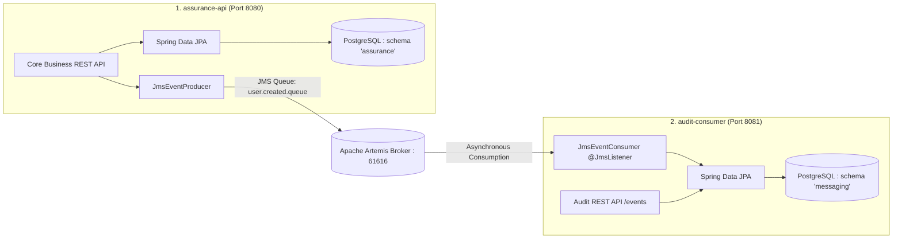

# Home Insurance System (Assurance Habitation)

A modern, multi-module Spring Boot application for Home Insurance management, featuring asynchronous event-driven messaging with Apache ActiveMQ Artemis and PostgreSQL multi-schema persistence.

---

## 🏛️ Architecture Overview

The project is structured as a decoupled two-service microservice system:



### 1. `assurance-api` (Port 8080 — Producer)
- Core insurance business domain: Policyholders, Accommodations, Coverages, Contracts, Claims.
- Connects exclusively to the PostgreSQL **`assurance`** schema.
- Emits business domain events (`USER_CREATED`, `CONTRACT_CREATED`, `CLAIM_CREATED`) to Apache Artemis queues.
- Interactive Swagger UI: [http://localhost:8080/swagger-ui.html](http://localhost:8080/swagger-ui.html)

### 2. `audit-consumer` (Port 8081 — Consumer)
- Independent audit logging and event consumption service.
- Connects exclusively to the PostgreSQL **`messaging`** schema.
- Listens to Artemis queues via `@JmsListener` and stores immutable audit logs with dual timestamps (event emission time vs. consumer receipt time).
- Exposes audit trail endpoints (`GET /events`, `GET /events/{id}`).
- Interactive Swagger UI: [http://localhost:8081/swagger-ui.html](http://localhost:8081/swagger-ui.html)

---

## 🎯 Design Patterns Implemented

| Design Pattern | Implementation Location | Purpose & Justification |
|---|---|---|
| **Event Message** | `com.example.assurancehabitation.messaging.EventMessage` | Structures domain events into standardized `{ eventType, payload, eventTime }` wrappers. |
| **Message Translator** | `com.example.assurancehabitation.messaging.producer.JmsEventProducer` | Converts rich domain entities and DTOs into JSON message payloads sent across JMS channels. |
| **Event-driven Consumer** | `com.example.auditconsumer.messaging.JmsEventConsumer` | Autonomous `@JmsListener` endpoints that react to incoming messages without polling. |
| **Embedded Value** | `com.example.assurancehabitation.entity.assurance.Address` | Groups cohesive address fields (`street`, `city`, `country`, `postalCode`) into an `@Embeddable` value object. |
| **Lazy Load** | All entities in `entity.assurance.*` | Leverages `FetchType.LAZY` across `@OneToMany`, `@ManyToOne`, and `@ManyToMany` relations to optimize queries and avoid N+1 bottlenecks. |

---

## 🚀 Getting Started

You can run the entire system either **100% inside Docker** (no Java or Maven required on host) or in **Hybrid / Local Developer Mode** (fast iteration in IDE).

---

### Option 1: 🐳 100% Dockerized Stack (Zero Host Prerequisites)

> [!TIP]
> **Recommended for evaluation, demos, or running on a fresh computer.**
> You only need **Docker** installed. Java 25, Maven, PostgreSQL, and Artemis are completely containerized.

```bash
# Build and launch all 4 services (PostgreSQL, Artemis, assurance-api, audit-consumer)
docker compose up --build -d
```

To stop everything:
```bash
docker compose down
```

> [!IMPORTANT]
> **Database Initialization & Volume Reset**:
> The scripts in `./postgres/init/` (`10-permissions.sh`, `20-schema.sql`, `30-data.sql`) are executed **automatically by PostgreSQL only on the very first container startup when the volume is empty**.
> If you (or a teammate) previously ran an older commit where the database volume was created before the schema scripts were added, PostgreSQL skips initialization.
> To wipe the old volume and trigger a 100% fresh automated initialization and seeding:
> ```bash
> docker compose down -v
> docker compose up --build -d
> ```

---

### Option 2: 💻 Local Developer Mode (IntelliJ / Terminal)

> [!NOTE]
> **Recommended for active feature development and live debugging.**
> Requires Java 25, Maven, and Docker.

#### 1. Start Infrastructure (PostgreSQL & ActiveMQ Artemis)
```bash
docker compose up postgres artemis -d
```

> [!NOTE]
> Database schemas (`assurance`, `messaging`) and initial seed data (standard coverages, sample policyholders, sample contracts) are automatically loaded via scripts in `./postgres/init/` into persistent volume `postgres_data`.

#### 2. Run Automated Tests (42 Tests Across All Layers)
```bash
mvn test
```

##### 🧪 Test Coverage Across Architectural Layers

| Architectural Layer | `assurance-api` (Port 8080) | `audit-consumer` (Port 8081) | Focus & Assertions |
|---|---|---|---|
| **Controller Layer** | `UserControllerTest`, `ContractControllerTest`, `ClaimControllerTest` | `EventControllerTest` | `@WebMvcTest` MockMvc slice tests verifying HTTP statuses (200, 201, 204, 400, 404), Bean Validation constraints, and `@ExceptionHandler` responses. |
| **Service Layer** | `UserServiceTest`, `ContractServiceTest`, `ClaimServiceTest` | `EventServiceTest` | `@SpringBootTest` & Mockito unit tests verifying business logic, transactions, exception propagation, and JMS event dispatching. |
| **Repository Layer** | `AccommodationRepositoryTest`, `ContractRepositoryTest`, `ClaimRepositoryTest` | `EventRepositoryTest` | `@DataJpaTest` in-memory H2 tests verifying table mappings, `@Embedded` `Address`, enums, relationship navigation, and custom query methods. |
| **Messaging Layer** | `JmsEventProducerTest` | `JmsEventConsumerTest` | Unit tests verifying `EventMessage` envelope serialization, JMS listener routing, payload parsing, and error resilience. |

#### 3. Launch Applications Locally
Open two terminals:

```bash
# Terminal 1: Start Main Business API (Port 8080)
mvn spring-boot:run -pl assurance-api

# Terminal 2: Start Audit Consumer Service (Port 8081)
mvn spring-boot:run -pl audit-consumer
```

---

## 🛑 Shutting Down & Cleanup

### 1. Stopping Docker Stack
Depending on what you want to keep:

```bash
# Option A: Pause containers (keeps data and container state)
docker compose stop

# Option B: Stop and remove containers & network (preserves database data)
docker compose down

# Option C: Complete cleanup (removes containers, networks, AND database volumes)
docker compose down -v
```

### 2. Stopping Local Java / Maven Applications
- **In active terminal**: Press `Ctrl + C` in each terminal window.
- **If background processes linger on ports 8080 / 8081**:
  - **Windows (PowerShell)**:
    ```powershell
    Get-NetTCPConnection -LocalPort 8080, 8081 -ErrorAction SilentlyContinue | ForEach-Object { Stop-Process -Id $_.OwningProcess -Force }
    ```
  - **Linux / macOS**:
    ```bash
    kill -9 $(lsof -t -i:8080 -i:8081)
    ```

### 3. Check Port Availability
To verify that all project ports are free:
- **Windows (PowerShell)**:
  ```powershell
  Get-NetTCPConnection -LocalPort 8080, 8081, 5432, 61616, 8161 -ErrorAction SilentlyContinue
  ```
- **Linux / macOS**:
  ```bash
  lsof -i :8080,8081,5432,61616,8161
  ```

---

## 🌐 Endpoints & Documentation

- **Core API Swagger UI**: [http://localhost:8080/swagger-ui.html](http://localhost:8080/swagger-ui.html)
- **Audit Consumer Swagger UI**: [http://localhost:8081/swagger-ui.html](http://localhost:8081/swagger-ui.html)
- **Apache Artemis Console**: [http://localhost:8161](http://localhost:8161) (`atelier` / `atelier-local-uniquement`)

### 📮 Collection Postman

Une collection Postman v2.1 complète couvrant les **28 requêtes** des deux microservices est fournie dans le dépôt :
* **Fichier** : [`postman/assurance-habitation.postman_collection.json`](./postman/assurance-habitation.postman_collection.json)
* **Import** : Ouvrez Postman > Cliquez sur **Import** > Glissez-déposez le fichier `.json`.
* **Fonctionnalités incluses** :
  * Variables d'environnement préconfigurées (`assurance_url: http://localhost:8080`, `audit_url: http://localhost:8081`).
  * Enchaînement automatique : les requêtes de création `POST` sauvegardent automatiquement les IDs générés (`user_id`, `accommodation_id`, etc.) pour les requêtes suivantes (`GET`, `PUT`, `DELETE`).
  * Jeux de données réels et prêts à l'emploi.
