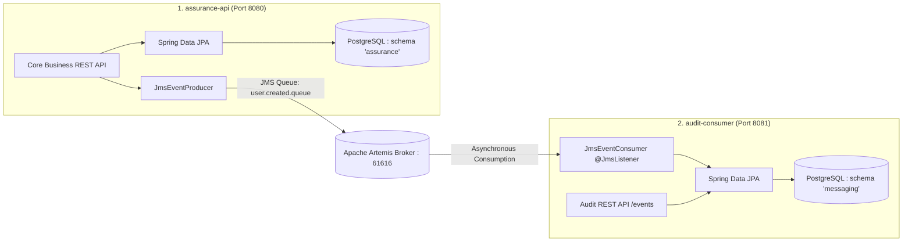

# Home Insurance System (Assurance Habitation)

A modern, multi-module Spring Boot application for Home Insurance management, featuring asynchronous event-driven messaging with Apache ActiveMQ Artemis and PostgreSQL multi-schema persistence.

---

## 🏛️ Architecture Overview

The project is structured as a decoupled two-service microservice system:



### 1. `assurance-api` (Port 8080 — Producer)
- Core insurance business domain: Policyholders, Accommodations, Coverages, Contracts, Claims.
- Connects exclusively to the PostgreSQL **`assurance`** schema.
- Emits business domain events (`USER_CREATED`, `CONTRACT_CREATED`, `CLAIM_CREATED`) to Apache Artemis queues.
- Interactive Swagger UI: [http://localhost:8080/swagger-ui.html](http://localhost:8080/swagger-ui.html)

### 2. `audit-consumer` (Port 8081 — Consumer)
- Independent audit logging and event consumption service.
- Connects exclusively to the PostgreSQL **`messaging`** schema.
- Listens to Artemis queues via `@JmsListener` and stores immutable audit logs with dual timestamps (event emission time vs. consumer receipt time).
- Exposes audit trail endpoints (`GET /events`, `GET /events/{id}`).
- Interactive Swagger UI: [http://localhost:8081/swagger-ui.html](http://localhost:8081/swagger-ui.html)

---

## 🎯 Design Patterns Implemented

| Design Pattern | Implementation Location | Purpose & Justification |
|---|---|---|
| **Event Message** | `com.example.assurancehabitation.messaging.EventMessage` | Structures domain events into standardized `{ eventType, payload, eventTime }` wrappers. |
| **Message Translator** | `com.example.assurancehabitation.messaging.producer.JmsEventProducer` | Converts rich domain entities and DTOs into JSON message payloads sent across JMS channels. |
| **Event-driven Consumer** | `com.example.auditconsumer.messaging.JmsEventConsumer` | Autonomous `@JmsListener` endpoints that react to incoming messages without polling. |
| **Embedded Value** | `com.example.assurancehabitation.entity.assurance.Address` | Groups cohesive address fields (`street`, `city`, `country`, `postalCode`) into an `@Embeddable` value object. |
| **Lazy Load** | All entities in `entity.assurance.*` | Leverages `FetchType.LAZY` across `@OneToMany`, `@ManyToOne`, and `@ManyToMany` relations to optimize queries and avoid N+1 bottlenecks. |

---

## 🚀 Getting Started

### Prerequisites
- Java 25
- Docker & Docker Compose
- Maven (or use `./mvnw`)

### 1. Start Infrastructure (PostgreSQL & Artemis)
```bash
docker compose up -d
```

> [!NOTE]
> Database schemas (`assurance`, `messaging`) and initial seed data (standard coverages, sample policyholders, sample contracts) are automatically loaded via scripts in `./postgres/init/`.

### 2. Run Automated Tests
```bash
mvn test
```

#### 🧪 Test Coverage Across Architectural Layers (42 Tests)

| Architectural Layer | `assurance-api` (Port 8080) | `audit-consumer` (Port 8081) | Focus & Assertions |
|---|---|---|---|
| **Controller Layer** | `UserControllerTest`, `ContractControllerTest`, `ClaimControllerTest` | `EventControllerTest` | `@WebMvcTest` MockMvc slice tests verifying HTTP statuses (200, 201, 204, 400, 404), Bean Validation constraints, and `@ExceptionHandler` responses. |
| **Service Layer** | `UserServiceTest`, `ContractServiceTest`, `ClaimServiceTest` | `EventServiceTest` | `@SpringBootTest` & Mockito unit tests verifying business logic, transactions, exception propagation, and JMS event dispatching. |
| **Repository Layer** | `AccommodationRepositoryTest`, `ContractRepositoryTest`, `ClaimRepositoryTest` | `EventRepositoryTest` | `@DataJpaTest` in-memory H2 tests verifying table mappings, `@Embedded` `Address`, enums, relationship navigation, and custom query methods. |
| **Messaging Layer** | `JmsEventProducerTest` | `JmsEventConsumerTest` | Unit tests verifying `EventMessage` envelope serialization, JMS listener routing, payload parsing, and error resilience. |

### 3. Launch the Applications
Open two terminals:

```bash
# Terminal 1: Start Main Business API (Port 8080)
mvn spring-boot:run -pl assurance-api

# Terminal 2: Start Audit Consumer Service (Port 8081)
mvn spring-boot:run -pl audit-consumer
```

---

## 🌐 Endpoints & Documentation

- **Core API Swagger UI**: [http://localhost:8080/swagger-ui.html](http://localhost:8080/swagger-ui.html)
- **Audit Consumer Swagger UI**: [http://localhost:8081/swagger-ui.html](http://localhost:8081/swagger-ui.html)
- **Apache Artemis Console**: [http://localhost:8161](http://localhost:8161) (`atelier` / `atelier-local-uniquement`)
